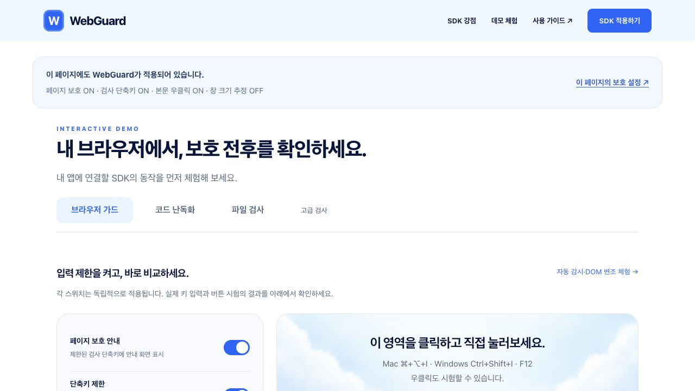
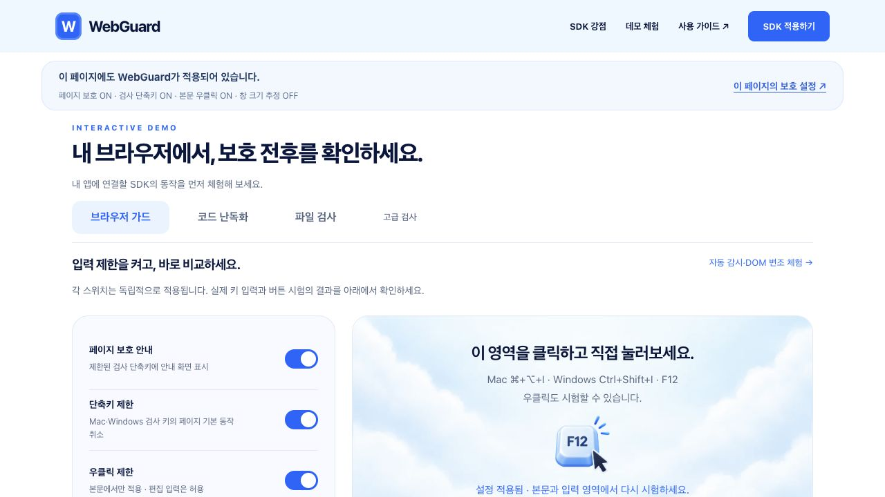
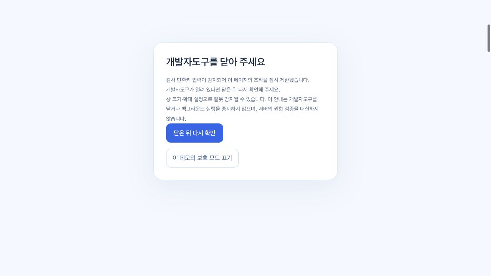
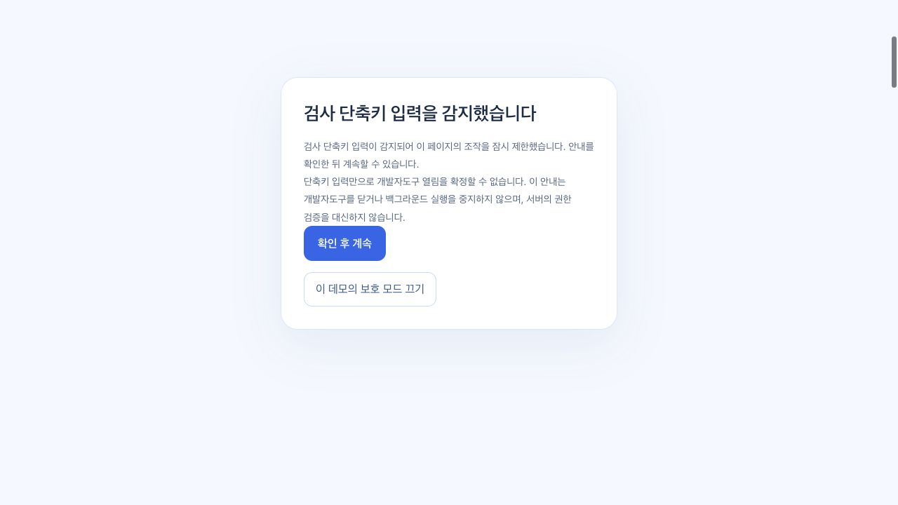
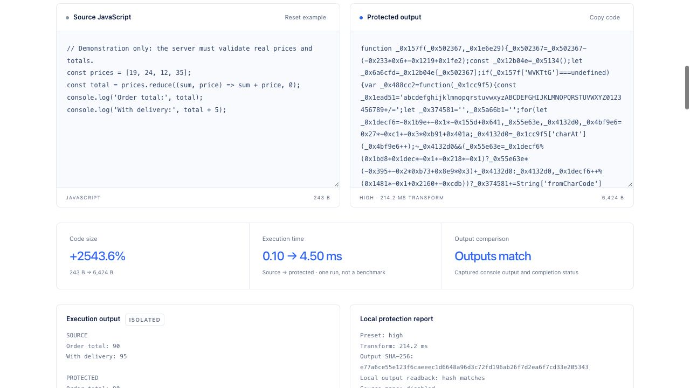
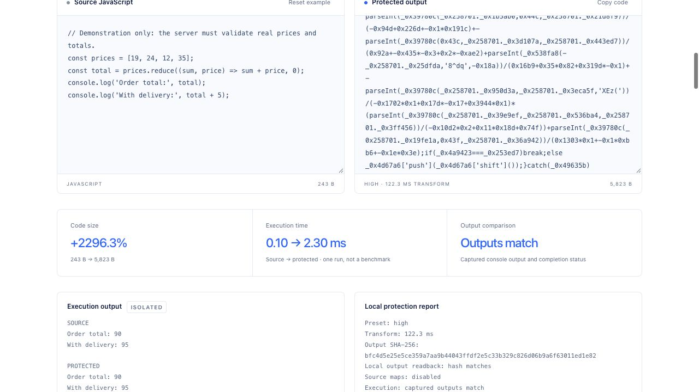
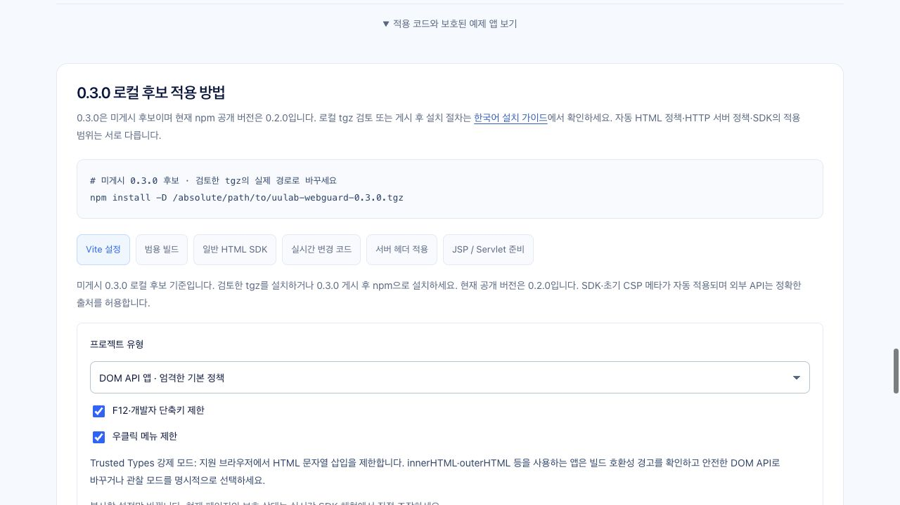
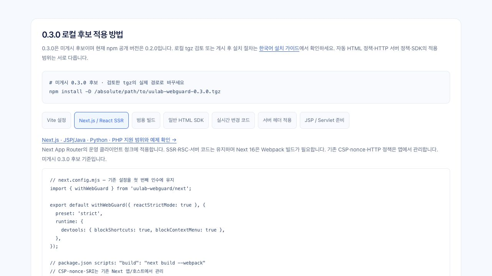
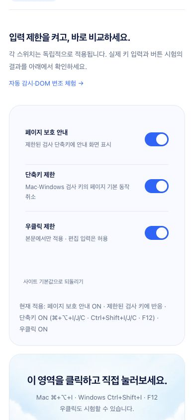
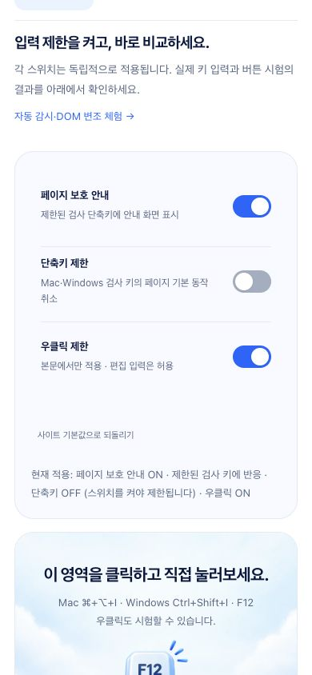

# WebGuard 전체 구성 리뷰 · 2026-10-22

이번 리뷰는 SDK를 주 제품으로 보고, 설치 → 빌드 보호 → 런타임 조작 → 배포 검사 → 공개 데모까지 확인했습니다. 현재 실행에서 공개 사이트를 직접 조작해 캡처한 화면을 사용했습니다. npm 게시 보류와 기존 `.npm-release` 후보는 유지합니다.

## 판정과 우선순위

기능을 더 나열하기보다 **보호 전 원본의 노출 경로, 실제 감지 누락, 설치 예제와 게시 후보의 일치**를 먼저 수정했습니다. 웹사이트를 잠그거나 개발자도구를 강제로 닫는 기능으로 평가하지 않습니다. 이 SDK는 난독화·브라우저 정책·런타임 신호·배포 검사를 연결하는 도구입니다.

| 우선순위 | 리뷰에서 재현한 문제                                                               | 조치                                                                                                                         |
| -------- | ---------------------------------------------------------------------------------- | ---------------------------------------------------------------------------------------------------------------------------- |
| P1       | 원본 `.js.gz`·`.js.br`과 압축 소스맵이 보호 출력에 남을 수 있음                    | 사전 압축 코드 입력 거부, 압축 비공개 파일 제거, 서버 경로 제한·배포 검사 강화. 일반 HTTP gzip/Brotli 전송은 유지            |
| P2       | Next 클라이언트 변환은 디렉터리/Vite와 달리 탐지 가능한 자격 증명 사전 검사가 빠짐 | 공개 `static/` 원문 검사, 값 없는 오류. 서버 헬퍼 보존. 압축 코드·압축 맵을 변환 전과 최종 단계에서 거부                     |
| P2       | 같은 부모 안에서 선택 DOM을 재배치하면 내용·조상이 같아 놓칠 수 있음               | 선택 요소와 관찰 조상 노드의 이동 기록 감지. 관련 없는 형제 변화는 허용. 위치 변화는 신뢰하는 명시적 재기준 설정 전까지 유지 |
| P2       | 검사 단축키만 눌러도 안내 제목이 개발자도구가 열렸다고 오해하게 함                 | 단축키·창 크기·DOM·실행 지연별 제목과 복귀 버튼 분리                                                                         |
| P2       | 같은 버전의 오래된 npm 후보가 최신 소스와 달라도 게시 절차에 들어갈 수 있음        | 공개 패키지 파일·빌드 입력 스냅샷 검사, 인증 전 거부, 레지스트리 조회 후 재검사. 기존 후보는 보존하고 거부됨을 확인          |
| P2       | 설치 체험에 Next 탭이 없고 첫 화면에서 조작부가 늦게 보임                          | Next/Webpack 예제·SSR 환경 가이드 연결, 첫 화면 간격 축소. 밝은 파란색 디자인 유지                                           |

## 직접 확인한 흐름

### 1. 데모 진입 · 개선

**리뷰 전:** 1280×720에서 상태 안내·소개·여백이 큰 비중을 차지하고 첫 스위치만 충분히 보였습니다. 첫 행동은 명확하지만 비교할 설정을 보려면 내려야 했습니다.

**조치:** 상단 안내와 제목·탭 간격을 줄였습니다. 소개를 없애지 않고 세 가지 기본 스위치를 첫 화면에 배치했습니다. 기능 탭과 SDK 소개·설치 흐름은 유지했습니다.

접근성: 색상 외에 스위치 이름·적용 상태 텍스트를 함께 제공합니다. 키보드 탭 전환과 모바일 가로 넘침은 브라우저 테스트로 확인하며, 화면만으로 WCAG 적합성을 판정하지 않습니다.

### 2. 입력 제한과 복귀 · 수정

**리뷰 전:** 합성 F12 시험만 실행해도 “개발자도구를 닫아 주세요”라고 표시했습니다. 실제 열린 도구를 감지한 것과 구분하기 어렵고, 동작하지 않는 서비스처럼 보이게 하는 원인이었습니다.

**조치:** 단축키에는 “검사 단축키 입력을 감지했습니다”와 “확인 후 계속”을 표시합니다. 창 크기 신호는 별도 문구를 사용합니다. 스위치는 독립적으로 적용하고, 안내의 닫기·데모 종료·초점 복귀를 테스트합니다.

접근성: 모달의 이름과 실제 제목을 일치시키고 복귀 버튼을 제공했습니다. 브라우저 자체 UI에서 여는 개발자도구를 닫거나 콘솔 실행을 막는 기능은 제공하지 않습니다.

### 3. 난독화와 실행 비교 · 정상, 설명 개선 여지

**현재 실행의 실제 비교:** 장바구니 예제를 High로 변환했습니다. 읽기 쉬운 원문과 변환 결과를 나란히 보여주고, 두 실행의 출력 `90`·`95`가 같았습니다. 코드 크기 증가도 숨기지 않습니다. 한 번의 시간 측정을 성능 벤치마크로 취급하지 않습니다.

앱 자체도 보호된 빌드로 배포합니다. 실제 자산 바이트·해시·소스맵 노출은 화면상의 코드 샘플과 별도로 검사합니다. 대용량 외부 변환 엔진은 Standard, 앱·SDK·실행 Worker는 Strict를 사용합니다.

접근성·남은 표현 문제: 긴 코드에는 독립 스크롤이 필요하며 하단 실행 결과에 영어 라벨이 남아 있습니다. 한국어 설명과 기능은 연결되어 있으나 전체 문구를 한국어로 통일하는 작업은 후속 시각 개선 항목입니다.

### 4. 내 프로젝트에 적용 · 수정

**리뷰 전:** Vite·범용·HTML·서버 예제는 있지만 실제 제공하는 Next 어댑터가 적용 탭에 없었습니다. npm 게시 보류로 설치 경로가 로컬 아카이브인 것은 의도한 상태입니다.

**조치:** “Next.js / React SSR” 탭에 `withWebGuard()`·`next build --webpack` 예제를 추가했습니다. JSP/Java·Python·PHP를 포함한 지원 범위 가이드를 연결하고 압축 파일 처리·서버 정책 책임·미게시 상태를 명시했습니다. `.next` 전체나 서버 소스를 범용 난독화 입력으로 안내하지 않습니다.

접근성: 선택 버튼은 눌림 상태를 제공하고 코드 복사 결과를 알립니다. 작은 화면의 가로 넘침과 탭 변경 시 기존 설정 보존은 테스트 대상입니다.

### 5. 모바일 조작 · 정상, 세로 스크롤 필요

390×844에서는 스위치와 시험 영역을 한 열로 배치합니다. 설정 이름과 실제 적용 상태가 보이고 가로 스크롤 없이 조작할 수 있습니다. 긴 고급 검사는 접혀 있습니다.

접근성·한계: 첫 화면에 모든 시험을 넣지는 않습니다. 포인터·키보드 조작과 스위치 상태를 테스트하며 실제 VoiceOver·확대 200%·사용자 보조기기 전체 검증은 이번 리뷰의 증거 범위에 포함하지 않습니다.

## 검증 기록

- 구현 커밋: `e3aa9c6` 및 배포 검사 후속 수정 `3f6fd67`.
- 단위·통합 검사: 40파일, **552개 통과**. 압축 원본 노출·후보 불일치·Next 사전 검사·DOM 이동을 실패 재현 후 수정했습니다.
- 로컬 화면 검사: **97개 통과**, Firefox/WebKit의 Chromium 전용 CDP 검사 2개 제외. 이후 첫 화면 전체 스위치 노출 검사도 세 엔진에서 통과했습니다.
- 루트 타입·Worker 타입·ESLint·Prettier, 배포 빌드·Wrangler dry run 통과.
- 새 임시 아카이브의 **34파일이 현재 패키지 빌드와 일치**하며, 같은 아카이브를 빈 Vite 8.3.4·Next 16.4.2/React 19.3.1 프로젝트에 각각 설치해 세 브라우저에서 검증했습니다. npm 레지스트리 게시 증거가 아닙니다.
- Webpack 5.112.0·esbuild 0.28.2·일반 HTML: 빌드 3종 및 브라우저 사례 12개 통과. Vite 의존성 없이 보호 후 계산·동적 import·자동 SDK·SRI 변조 거부를 확인했습니다.
- Python WSGI: 실제 HTTP 요청 14건과 세 브라우저에서 서버 렌더링·API·SDK 입력 정책·CSP·SRI 검증 통과. PHP는 실행 파일이 없어 이번 실행에서 제외했습니다. JSP/Java는 예제 구성을 검토했으며 Maven이 현재 PATH에 없어 기존 Java 실행 기록과 이번 검증을 구분합니다.
- 최종 공개 버전: `a706f45c-3018-4cde-8059-7e29f52935ae`, 트래픽 100%. 공개 파일 **40/40 SHA-256 일치**, 기존 Worker 런타임·ASSETS 바인딩 유지.
- 최종 공개 HTTP·브라우저 검사: **274개 통과, 오류 0개, CDP 전용 검사 2개 제외**. 재시도 없이 Chromium·Firefox·WebKit에서 통과했습니다. 실제 공개 자산의 압축 대체 경로 거부도 확인했습니다.
- 보류 중인 `.npm-release` 아카이브와 기록의 SHA-256이 시작 시점과 같습니다. `release:check`는 이 레거시 후보를 인증 전에 거부합니다. npm 로그인·게시를 시도하지 않았고 Codex 전역 설정도 변경하지 않았습니다.

[최종 배포·검증 영수증](evidence/review-2026-10-22/verification.json) · [파일별 공개/패키지 해시 기록](evidence/review-2026-10-22/readback.json) · [Vite 설치](evidence/review-2026-10-22/vite-consumer.json) · [Next 설치](evidence/review-2026-10-22/next-consumer.json) · [범용 설치](evidence/review-2026-10-22/generic-consumer.json) · [SSR 실행](evidence/review-2026-10-22/ssr-templates.json).

화면 01–05는 이 리뷰의 수정 전 공개 화면, 06–10은 첫 개선 배포, 11은 최종 공개 배포를 직접 캡처했습니다. 실험 OFF 상태가 보이는 모바일 화면은 설정 변경이 실제로 유지된 결과입니다. 모든 이미지는 저장한 파일을 다시 열어 확인했습니다.

## 보호 범위와 남은 한계

- 브라우저에 전달된 HTML·CSS·JavaScript는 관찰할 수 있습니다. 난독화는 분석 비용을 높이며 비밀 저장소가 아닙니다.
- 개발자도구의 열림·닫힘을 확실히 판정하거나 브라우저 메뉴·콘솔 실행을 SDK가 제어하지 않습니다. 실행 지연은 재개 후 측정하는 신호이며 부하·절전 등의 오탐이 가능합니다.
- CSP·SRI의 신뢰 기준과 HTTP 헤더·비공개 파일 차단은 배포 호스트에 적용해야 합니다. 인증·인가·가격·권한은 앱 서버가 검증해야 합니다.
- 원격 경로 검사는 정해진 후보와 보고서에 기록한 경로를 확인합니다. 임의의 모든 원격 파일명을 열거하지 않습니다.
- 게시 검사는 후보와 현재 파일의 불일치를 막습니다. 검사가 끝난 뒤 로컬 파일을 동시에 바꾸는 적대적 프로세스를 잠그는 OS 보안 경계는 아닙니다.
- npm 게시 보류를 유지합니다. 새 검증 아카이브는 임시 경로에 생성하고 기존 보류 후보를 덮어쓰지 않습니다.
