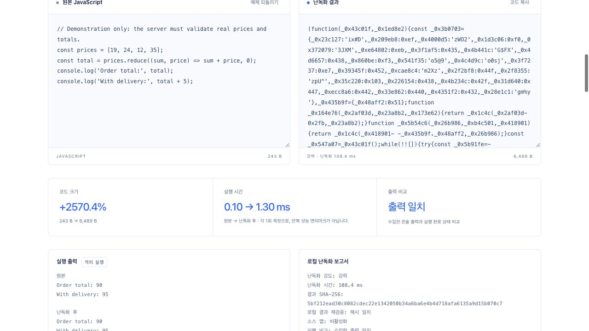
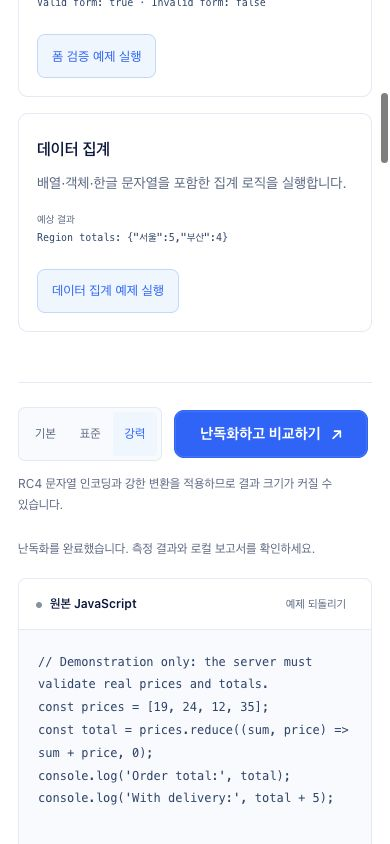
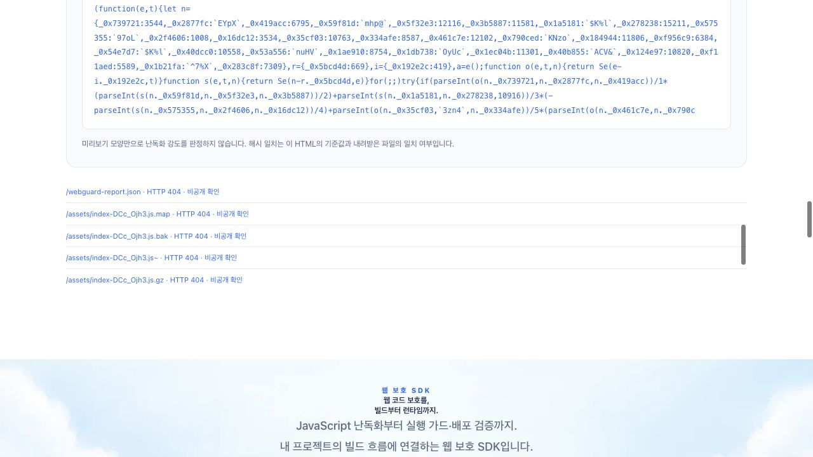

# WebGuard SDK 후속 개선 · 2026-10-22

npm 게시를 보류한 상태에서 SDK의 보호 누락과 데모 결과의 신뢰도를 개선했습니다. 기존 밝은 파란색 디자인과 API 식별자는 유지했습니다.

## 이번에 재현하고 수정한 문제

1. **뒤늦은 Vite 출력 경로 변경.** 다른 플러그인의 post `outputOptions`가 경로를 바꾸면 WebGuard가 중간 설정만 검증하고, 최종 디렉터리의 SRI·비공개 파일 정리를 놓칠 수 있었습니다. 청크 난독화가 일부 실행되어도 전체 보호가 완료됐다는 뜻은 아닙니다. 최종 `generateBundle`에서 쓰기 전에 다시 검증하고 `writeBundle`에서도 성공 기록 전에 재검증합니다. 회귀 테스트는 보호되지 않은 경로가 생기지 않고 `emptyOutDir: false`의 기존 파일이 그대로임을 확인합니다. Vite 전체 빌드의 임의 파일 삭제까지 되돌리는 기능은 아닙니다.

2. **백업·임시 파일 노출.** `app.js.bak`이 실제 Vite 출력에 남고 예제 HTTP 서버에서 200으로 내려오는 것을 재현했습니다. `.bak`·`.backup`·`.old`·`.orig`·`.save`·`.swp`·`.swo`·`.tmp`·`~` 및 gzip/Brotli로 감싼 백업을 비공개로 분류합니다. 범용/Vite 출력에서는 제거하고 원본 입력은 보존합니다. 서버는 404로 거부하며 Next 공개 `static/` 컴파일에서는 초반·최종 단계 모두 오류로 중단합니다. 정상 `catalog.old.json`·백업 사용법 문서·원본 라이선스 고지는 유지합니다. 원격 검사는 알려진 코드의 `.bak`·`~` 대체 경로와 보고서에 기록된 제거 경로를 확인합니다. 모든 임의 백업명을 열거하는 것은 아닙니다.

3. **일부 링크의 SRI 누락.** `rel="StyleSheet"`, `rel="alternate stylesheet"`, 공백·대소문자가 섞인 `modulepreload`가 기존 단일 소문자 비교에서 누락됐습니다. [HTML 표준](https://html.spec.whatwg.org/multipage/semantics.html#attr-link-rel)에 맞게 토큰을 판별해 최종 바이트의 SRI를 연결합니다. 실제 브라우저 회귀 검사에서 원본 CSS의 파란색 적용과, HTML의 해시는 유지한 채 CSS를 변조했을 때 스타일이 거부되는 것을 비교합니다. 다른 출처나 지원하지 않는 링크 종류를 모두 자동 보호한다는 주장은 하지 않습니다.

4. **이전 난독화 결과의 잘못된 상태.** 강도를 바꿨는데도 이전 ‘출력 일치’ 표시가 남거나, 같은 강도를 다시 선택했을 뿐인데 결과가 낡았다고 표시했습니다. 실제 강도가 바뀔 때만 ‘갱신 필요’로 표시하고 재실행 후 새 결과를 사용합니다. 같은 강도 선택은 완료 상태를 보존하며 초기 설명도 정상 표시합니다.

5. **데모 안내와 기능 연결.** 난독화 버튼·원본/결과 라벨·진행/오류/결과·로컬 보고서·보호 범위를 한국어로 정리했습니다. 기본/표준/강력이라는 표시 이름과 실제 API `basic`/`standard`/`high`는 구분합니다. 시간은 한 번의 측정임을 명시합니다. 실제 배포 리소스 검사에는 엔트리의 백업·압축 URL 검사를 추가했습니다. 엔트리 해시가 맞더라도 백업 노출은 전체 검사 실패로 표시하고 비공개 파일 본문은 미리보기에 표시하지 않습니다.

## 검증

- 단위·통합: **569개 / 40파일 통과**.
- 공개 HTTP·브라우저: **286개 통과, 오류 0개, Chromium 전용 CDP 검사 2개 제외**. 재시도 없이 Chromium·Firefox·WebKit에서 확인했습니다. 혼합 `rel` CSS의 정상 적용·변조 거부와 새 결과 상태 회귀도 포함합니다.
- 루트 타입·Worker 타입·ESLint·Prettier·빌드·Wrangler dry run 통과.
- 같은 새 임시 패키지를 빈 Vite **7.3.1 / 8.3.4**, Next **16.4.2 / React 19.3.1** 프로젝트에 각각 설치해 실제 빌드와 세 엔진 실행을 확인했습니다. Vite 7 패키지 검사기의 이전 허용 목록이 Next 배포 파일을 빠뜨린 문제도 수정하고 재검증했습니다. 이는 npm 게시 증거가 아닙니다.
- 로컬 화면 검사의 최초 진단 실패는 새 의도적 404 경로를 기존 시험 로그 목록이 알지 못한 경우였습니다. 임의 오류를 무시하지 않고, 실제 엔트리와 고정 시험 URL만 정확히 구분하도록 고친 뒤 진단 3개와 공개 전체 검사가 통과했습니다.
- 공개 자산 **40/40 SHA-256**, 패키지 **34/34 파일 바이트** 일치. Worker 버전 `423bdaa9-7167-4a7e-9adf-ce9d0e908f5a`, 트래픽 100%, 기존 런타임·ASSETS 바인딩 유지.
- npm 보류 후보와 기록은 그대로입니다. `release:check`는 레거시 후보를 인증 전에 거부하며 로그인·게시를 시도하지 않았습니다. Codex 전역 설정은 변경하지 않았습니다.
- 이번 실행에서는 PHP·Java 서버를 다시 실행하지 않았습니다. 이전 증거를 새 검증으로 합산하지 않습니다.

[검증 영수증](evidence/sdk-polish-2026-10-22/verification.json) · [파일별 바이트 확인](evidence/sdk-polish-2026-10-22/readback.json) · [Vite 7](evidence/sdk-polish-2026-10-22/vite7.json) · [Vite 8](evidence/sdk-polish-2026-10-22/vite8.json) · [Next](evidence/sdk-polish-2026-10-22/next.json).

## 공개 화면에서 확인한 결과

강력 난독화의 원본·결과와 출력 일치를 한국어로 확인했습니다. 예제의 실제 콘솔 문자열은 코드와 함께 유지했습니다.

390×844에서 강력 설정을 다시 선택해 완료 상태가 유지되고 버튼·설명에 가로 넘침이 없음을 확인했습니다. 확인 후 창 크기 설정을 복원했습니다.

실제 공개 엔트리는 200·SHA-384 일치, 백업·압축 대체 경로는 404로 표시됐습니다. 브라우저에서 내려받은 자체 앱 코드의 난독화 미리보기도 함께 확인했습니다.

## 범위

이 작업은 SDK의 빌드 보호·정책 연결·검사와 데모의 정확도를 높입니다. 브라우저가 소유한 개발자도구를 강제로 닫거나 전달된 HTML/JavaScript를 완전히 숨기지는 않습니다. 파일 무결성 기준과 인증·인가·가격 검증은 신뢰하는 배포 환경과 서버가 관리해야 합니다.
